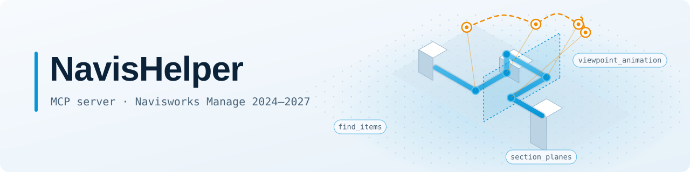

<div align="center">

<picture>
  <source media="(prefers-color-scheme: dark)" srcset="docs/assets/banner-dark.svg">
  
</picture>

**AI-помощник и панель для Autodesk Navisworks Manage 2024–2027**

Скажите Claude, Codex или Cursor, что нужно сделать в модели, и NavisHelper выполнит это прямо в открытом Navisworks.

[](https://github.com/mikhalchankasm/NavisWorksMaster/releases/latest)
[](#требования)
[](LICENSE)

**[⬇ Скачать установщик](https://github.com/mikhalchankasm/NavisWorksMaster/releases/latest)** · [Готовые запросы](docs/prompts/animation/README.md) · [English](README.md)

</div>

<!-- Промо-ролик: сюда встанет короткий ролик облёта. -->

## Что умеет

- **Найти и показать.** Выделить элементы по имени или свойству, скрыть, изолировать, раскрасить.
- **Коллизии.** Разобрать результаты Clash Detective, сгруппировать, изолировать коллизию, сохранить виды и отчёты.
- **Виды и сечения.** Вид на каждый элемент, плоскости и рамки сечения, пометки.
- **Облёты.** Анимации из сохранённых видов с выгрузкой в PNG, JPG или AVI.
- **Отчёты.** Свойства и имена из дерева модели в Excel.

Работает из панели NavisHelper или из любой AI-программы, которая подключает MCP-серверы. Каждое изменение AI сначала показывает и делает только после вашего подтверждения.

## Примеры запросов

> «Найди все насосы, выдели их и приблизь вид».

> «Покажи активные коллизии в тесте `HVAC vs Structure` и изолируй первую».

> «Сделай облёт вдоль трассы КИП и выгрузи его в видео».

> «Выгрузи свойства выделенных элементов в Excel».

Ещё: [готовые запросы для облёта](docs/prompts/animation/README.md) · [пошаговые сценарии](docs/USER_WORKFLOWS.md)

## Установка

Скачайте `NavisHelperSetup-<версия>.exe` из [последнего выпуска](https://github.com/mikhalchankasm/NavisWorksMaster/releases/latest) и запустите его. Сначала закройте Navisworks; права администратора не нужны.

1. **Откройте Navisworks.** На ленте появится вкладка **NavisHelper**, кнопка **NavisHelper** на ней открывает панель.
2. **Перезапустите AI-программы**, которыми пользуетесь. Если флажок на последней странице установщика остался включён, NavisHelper уже к ним подключён.
3. **Claude Desktop:** Settings → Extensions → установка из файла → `NavisHelper.mcpb`. Папку с ним открывает ярлык «Расширение NavisHelper для Claude Desktop» в меню «Пуск».

### Требования

- Autodesk Navisworks Manage 2024, 2025, 2026 или 2027, Windows x64.
- .NET 9 Runtime; если его нет, установщик предложит скачать.
- Для работы с AI: любая программа, которая подключает MCP-серверы (Claude Code, Claude Desktop, Codex, Cursor и другие). Панели AI не нужен.

> [!IMPORTANT]
> **Анимации из точек обзора создаются только в Navisworks 2026 и 2027.** API версий 2024 и 2025 не умеет их создавать:
> там `viewpoint_animation` показывает план, но не сохраняет анимацию. Список и удаление анимаций работают во всех версиях.
> Выгрузка анимации в PNG, JPG и AVI проверена вживую только в 2027.

<details>
<summary>Другие способы установки</summary>

ZIP, установка AI-агентом и ручная настройка клиентов описаны в [руководстве по установке](docs/MCP_DISTRIBUTION_PLAN.md).

</details>

### Проверка файла

<details>
<summary>Скачать, проверить SHA256 и запустить из PowerShell</summary>

Выполните три блока в одной сессии PowerShell:

```powershell
$release = Invoke-RestMethod `
  "https://api.github.com/repos/mikhalchankasm/NavisWorksMaster/releases/latest"
$installerAsset = $release.assets |
  Where-Object name -Like "NavisHelperSetup-*.exe" |
  Select-Object -First 1
$checksumsAsset = $release.assets |
  Where-Object name -Like "SHA256SUMS*.txt" |
  Select-Object -First 1
if (-not $installerAsset -or -not $checksumsAsset) {
  throw "Required release assets were not found."
}
```

```powershell
$installer = Join-Path $env:TEMP $installerAsset.name
$checksums = Join-Path $env:TEMP $checksumsAsset.name
Invoke-WebRequest $installerAsset.browser_download_url -OutFile $installer
Invoke-WebRequest $checksumsAsset.browser_download_url -OutFile $checksums
$line = Get-Content $checksums |
  Where-Object { $_ -match "^\s*[0-9A-Fa-f]{64}\s+\*?$([regex]::Escape($installerAsset.name))\s*$" } |
  Select-Object -First 1
$expected = ($line -split "\s+")[0]
$actual = (Get-FileHash $installer -Algorithm SHA256).Hash
if (-not $expected -or $actual -ne $expected) {
  throw "Installer checksum verification failed."
}
```

```powershell
if (Get-Process Roamer -ErrorAction SilentlyContinue) {
  throw "Close Navisworks before installing."
}
Start-Process $installer -Wait
```

</details>

## Безопасность

- **Всё локально.** NavisHelper не открывает сетевых портов, AI-программа связывается с Navisworks только на вашем компьютере.
- **Сначала показ, потом действие.** Изменяющие команды показывают, что будет сделано, и выполняются только после подтверждения.
- **Защищённый режим.** Если включить его в настройках панели, любое изменение документа агентом ждёт вашего «Разрешить».

Подробнее — в [безопасности и совместимости](docs/SECURITY_AND_COMPATIBILITY.md).

## Документация

<details>
<summary>Руководства, контракты, выпуски</summary>

| Если нужно | Читайте |
|---|---|
| Начать работу с AI | [Быстрый старт](docs/NAVISWORKS_MCP_QUICKSTART.md) |
| Готовые сценарии | [Пользовательские сценарии](docs/USER_WORKFLOWS.md) |
| Настроить AI-программы | [Руководство по клиентам](docs/MCP_CLIENT_GUIDE.md) |
| Что нового | [Выпуски](https://github.com/mikhalchankasm/NavisWorksMaster/releases) |
| Подробности о продукте, сравнение, проверки | [Подробности о проекте](docs/reference/PROJECT_DETAILS.ru.md) |
| Создать анимацию из сохранённых точек маршрута | [Контракт viewpoint_animation](docs/MCP_TOOL_CONTRACTS.md#viewpoint_animation) |
| Проверить экспорт анимации и узнать опции экспортёра | [Контракт viewpoint_animation_export](docs/MCP_TOOL_CONTRACTS.md#viewpoint_animation_export) |
| Взять готовый запрос: облёт трассы, обход с подрезами, проход по коллизиям, с пресетами качества и сжатием в MP4 | [Готовые запросы для анимации](docs/prompts/animation/README.md) |

</details>

## Для разработчиков

<details>
<summary>Число инструментов, контракты, архитектура, сборка</summary>

В исходниках зарегистрировано **127 разных MCP-инструментов**. `scripts/check_mcp_command_catalog.py` выводит их имена из 127 методов `[McpServerTool]` и проверяет сгенерированный индекс из 127 строк. Входы, выходы и ограничения каждого описаны в [контрактах инструментов](docs/MCP_TOOL_CONTRACTS.md), устройство — в [архитектуре](docs/MCP_ARCHITECTURE.md). Сборка и правила вклада — в [Contributing](CONTRIBUTING.md) и [правилах сборки](BUILD_BUNDLE_RULES.md).

</details>

## Лицензия

[MIT License](LICENSE), сторонние уведомления — в [THIRD-PARTY-NOTICES.md](THIRD-PARTY-NOTICES.md). Проект поддерживается с низкой активностью: pull requests приветствуются, ответы на issues не гарантируются.

<sub>Autodesk и Navisworks являются зарегистрированными товарными знаками или товарными знаками Autodesk, Inc. и/или её дочерних и аффилированных компаний. NavisHelper — независимый проект; он не связан с Autodesk, не авторизован, не одобрен и не спонсируется Autodesk, Inc. См. официальный [список товарных знаков](https://www.autodesk.com/company/legal-notices-trademarks/intellectual-property/trademarks) и [правила для совместимых продуктов](https://www.autodesk.com/company/legal-notices-trademarks/trademarks/guidelines-for-use).</sub>
